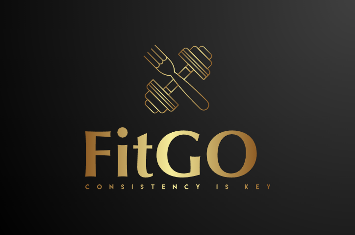
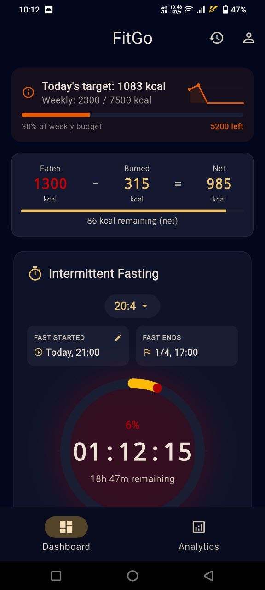
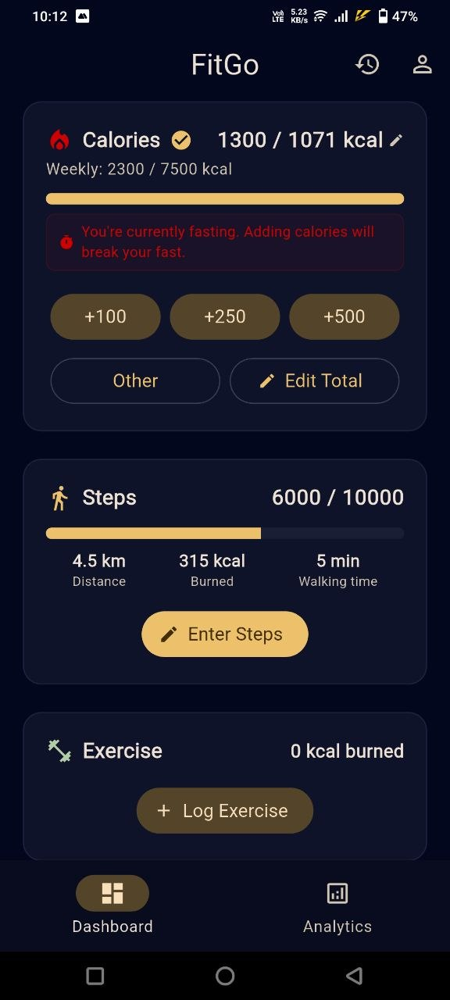
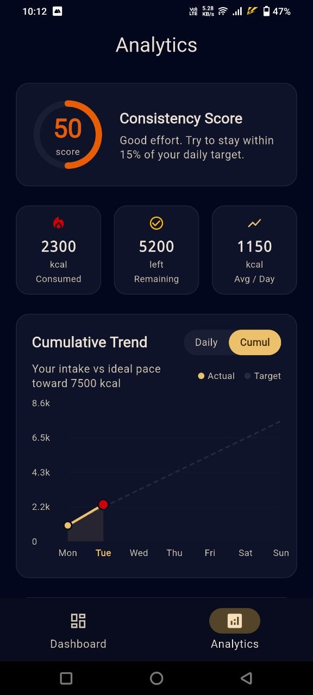
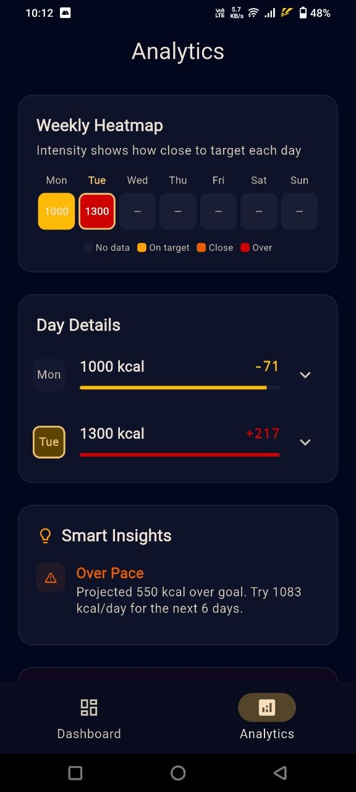

  

<h1 align="center">FitGo</h1>

  Offline-first daily fitness tracking for calories, fasting, hydration, activity, sleep, weight, and progress trends.

  
  
  

FitGo keeps the daily routine simple. Add a meal, record water, start a fast, log activity, and review your progress without needing an internet connection. Your information is saved on the device first. Sign in only when you want a private cloud backup and cross-device access.

> FitGo is a personal tracking tool. It does not replace medical, nutritional, or clinical advice.

---

## App preview

  
  
  
  

---

## What you can do

| Area | What FitGo provides |
| --- | --- |
| Daily calories | Log named meals, calories, and optional macros. Reuse recent or saved meals, adjust portions, remove an entry, and undo a recent action. |
| Weekly budget | Set a weekly calorie budget. FitGo shows the remaining daily amount and adjusts the pace across the rest of the week. |
| Fasting | Start a 16:8, 18:6, 20:4, 24-hour, or 36-hour fast. The timer keeps counting from its start time after app restarts. |
| Water | Add water in one tap, undo an accidental entry, and use a goal based on your profile. |
| Activity and sleep | Manually record steps, exercise, calories burned, bedtime, wake time, and sleep duration. |
| Weight | Log body weight, view a trend chart, and see your BMI in Profile. |
| Goal plan | Choose a target weight and date. FitGo shows the raw calorie target; a negative result is explained but does not block saving. |
| Intake forecast | Enter a daily intake to see an estimated weight on the selected goal date. This local estimate excludes activity. |
| Trends | Compare intake with budget by week, month, or year. Open a prior day to review or correct its log. |
| Reminders | Use fasting reminders and a monthly calorie guard that warns before a chosen monthly limit. |
| Appearance and units | Follow the device theme or choose light or dark mode. Switch between metric and imperial units. |
| Backup | Use FitGo as a local guest, or sign in with email, Google, or Apple to back up your data with Supabase. |
| Optional AI coach | Add your own Gemini API key for read-only, data-aware coaching inside the app. |

---

## Your first five minutes

1. Open FitGo and choose **Continue without an account** for a local guest profile, or create an account to enable backup.
2. Complete the short setup with your body details, activity level, and preferred goal.
3. Open **Profile → Goals → Goal plan** if you want a target weight and date. FitGo will show a practical daily calorie and water target.
4. Go to **Today** and add your first meal, water entry, fast, or health log.
5. Return to **Trends** after a few days to review your intake against the budget.

You can use all daily tracking features while offline. An account is optional for using the app.

---

## How to use FitGo every day

### Today

**Today** is the fast logging screen.

- Tap **Log meal** to choose a recent meal, choose a saved meal, or enter a meal name and calories.
- Expand **Details (macros)** only when you want to log protein, carbs, fat, fibre, or sugar.
- Enable **Save to my meals** to make a meal available next time.
- Tap **Water** for a quick drink entry. FitGo gives you an **Undo** action after logging.
- Tap **Fasting** and choose a fasting window. You can also record an earlier start time when needed.
- Open **Health** to manually log activity, sleep, or weight.

The calorie hero shows the amount still available for today. If you log less or more than expected, the weekly budget recalculates the remaining pace.

### Meals and nutrition

FitGo prioritizes speed over a large food catalogue.

- Enter a meal name and calories yourself.
- Add optional macro details when you have them.
- Tap a recent or saved meal to refill the form.
- Change a saved meal portion from 0.5× to 4×.
- Delete a meal from today's list when it was logged by mistake.

There is no built-in barcode scanner or external food database yet.

### Fasting

Choose from **16:8**, **18:6**, **20:4**, **24h**, or **36h**.

- Start a preset from **Today → Fasting**.
- Watch elapsed time, time remaining, and overtime after the target is reached.
- Change the duration while a fast is active.
- End a fast whenever you need to.
- Turn on fasting reminders when you want prompts during a fast.

The timer is timestamp-based, so it continues correctly after the app is closed or the phone restarts.

### Water, activity, sleep, and weight

- **Water** uses a quick-add action and a personal daily target.
- **Activity** lets you enter steps and add exercise. Calorie burn is estimated from the activity and profile information.
- **Sleep** records bedtime and wake time for a daily sleep total.
- **Weight** stores an entry for the day and shows a recent trend chart.

These are manual logs in the current release. Apple Health, Health Connect, wearable, and pedometer syncing are future work.

### Trends and past days

Open **Trends** to see:

- Total intake compared with the budget
- Week, month, and year views
- A plain-language insight based on your current logs
- Day and month history

Tap a past day to review or update its food, water, activity, sleep, and weight information. Changes refresh the relevant trends and goal calculations.

### Profile and goal planning

**Profile** groups settings into Goals, Preferences, Account & Backup, and Help & Privacy.

- Update body details, calorie budget, water target, activity level, and weight goal.
- Use **Goal plan** for a target weight and date.
- The planner uses the raw calculated target. If required intake is negative, FitGo explains the date is unreachable through calorie intake alone and still lets you save the goal.
- Switch between metric and imperial units at any time. Data remains stored consistently in the background.
- Choose System, Light, or Dark appearance.
- Enable the monthly calorie guard and set its limit, alert time, and message.

---

## Offline, backup, and privacy

FitGo is designed to remain useful without a connection.

| Situation | What happens |
| --- | --- |
| You are offline | Your changes save on the device immediately. You can continue logging normally. |
| You use a guest profile | Data stays only on that device until you explicitly import it after signing in. |
| You are signed in | Changes queue locally and upload to your private Supabase backup when a connection is available. |
| You have pending changes | The sync badge shows that information is saved locally and waiting to upload. |
| You move from guest to an account | Use **Profile → Account & Backup → Import guest data** after signing in. |
| You sign out | FitGo returns to a separate guest space. Account data is kept isolated from guest data. |

Cloud refresh is pull-first and avoids replacing local changes that have not uploaded yet. For now, avoid editing the same day on two devices at the same time. A daily record is currently synced as one unit, so simultaneous changes can conflict.

FitGo stores account backups in Supabase with row-level access controls. It does not sell tracking data or use it for advertising.

---

## Optional AI coach

The AI coach is completely optional and requires your own Google Gemini API key.

1. Open **Profile → Preferences → AI coach**.
2. Add your personal Gemini key.
3. Choose **Chat** to ask about your logged progress.

FitGo prepares a compact, privacy-minimized snapshot of your recent tracking data. It excludes your name, email, account ID, and API key. The key is kept in platform secure storage for that account, while AI chat history stays on the device and can be deleted.

The coach is read-only. It cannot change your goals or log data. Treat responses as general information rather than medical advice.

---

## Notifications

FitGo requests notification access only after you choose a reminder feature.

- **Fasting reminders** can prompt you while a fast is active.
- **Monthly Calorie Guard** can notify you before your monthly calorie limit is exceeded.
- Notification taps take you back to the relevant FitGo screen. Some notifications include quick actions such as adding water or ending a fast.

Your operating system can delay or suppress notifications because of battery, focus, or permission settings. Check device notification settings if reminders do not arrive.

---

## Platform status

FitGo is built with Flutter and has adaptive mobile layouts.

| Platform | Status |
| --- | --- |
| Android | Supported for development and release builds. Android 13 and later can request notification permission. |
| iPhone and iPad | iOS project foundation includes Sign in with Apple, notification callbacks, adaptive navigation, and iOS 16 deployment support. Building and TestFlight testing require macOS and Xcode. |
| Tablet layouts | Wider screens use a navigation rail and retain each main section while switching tabs. |

Before public App Store distribution, complete real iPhone and iPad testing, publish the Privacy, Terms, and Support pages, and add the required in-app account deletion flow.

---

## Run the project locally

### Requirements

- Flutter 3.41 or newer
- Dart 3.10 or newer
- Android Studio and an Android emulator or device for Android development
- macOS, Xcode, and CocoaPods for iOS builds
- A Supabase project when you want your own backend

### Install and run

\`\`\`bash
git clone https://github.com/YOUR_USERNAME/FitGo.git
cd FitGo
flutter pub get
flutter analyze
flutter test
flutter run
\`\`\`

If generated Hive files need to be refreshed after changing a model, run:

\`\`\`bash
dart run build_runner build --delete-conflicting-outputs
\`\`\`

### Build Android

\`\`\`bash
flutter build apk --release
flutter build appbundle --release
\`\`\`

The APK is written to \`build/app/outputs/flutter-apk/app-release.apk\`.

### Build iOS

Run this on macOS with Xcode and CocoaPods installed:

\`\`\`bash
flutter pub get
cd ios
pod install
cd ..
flutter build ipa --release
\`\`\`

---

## Configure your own backend

The repository currently points at a configured Supabase project. Before distributing a fork, create your own Supabase project and update \`lib/core/supabase_config.dart\`.

1. Apply the migration in \`supabase/migrations/\`.
2. Enable the authentication methods you plan to offer.
3. Add \`com.fitgo.fitgo://login-callback\` to Supabase Auth redirect URLs.
4. For Google sign-in, configure a Google OAuth web client in Supabase.
5. For Apple sign-in, enable the Apple provider in Supabase and configure the Apple capability in Xcode.
6. Never put a Supabase service-role key or an Apple private key in the Flutter app.

The supporting schema and local Supabase workflow are documented in [supabase/README.md](supabase/README.md).

---

## Project map

| Location | Purpose |
| --- | --- |
| \`lib/screens/\` | Today, Trends, Profile, authentication, onboarding, past-day editing, and AI chat screens |
| \`lib/ui/\` | Shared responsive components, sheets, theme tokens, and adaptive navigation |
| \`lib/providers/\` | App state for logs, goals, sync, units, notifications, and AI |
| \`lib/services/\` | Hive storage, Supabase sync, notifications, and optional AI services |
| \`supabase/migrations/\` | Versioned database schema |
| \`test/\` | Unit and widget coverage for goals, logs, sync behavior, UI layout, and AI safeguards |
| \`upgrade.md\` | Product roadmap, verification notes, and remaining release work |

---

## Known limitations

- Food, water, activity, sleep, and weight are user-entered records in this version.
- No Apple Health, Health Connect, wearable, barcode scanning, progress-photo, Face ID lock, or Live Activity feature is active yet.
- Same-day simultaneous edits on two offline devices do not have field-level conflict merging.
- The public privacy, terms, and support links are placeholders until the FitGo website is published.
- An App Store-ready account deletion and Apple token-revocation flow still needs to be completed.

---

Built with Flutter, Riverpod, Hive, Supabase, and optional Gemini integration.
